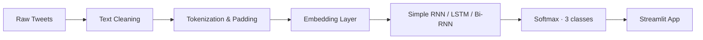

<div align="center">

# 🚫 Hate Speech Detection with Deep Learning

**An NLP pipeline that classifies tweets as hate, offensive or normal speech using recurrent neural networks — deployed as a Streamlit app.**


</div>

---

## 📌 Overview

Harmful content spreads quickly on social platforms. This project builds and compares three recurrent
architectures for **3-class tweet classification** on a labelled dataset of **24,783 tweets**:

| Class | Label |
|---|---|
| 0 | Hate Speech |
| 1 | Normal Speech |
| 2 | Offensive Speech |

## 🔄 Pipeline



**Preprocessing:** lowercasing · URL, punctuation and number removal · stop-word removal · tokenization · lemmatization

**Class imbalance:** handled with balanced class weights during training.

## 📊 Results

| Model | Notes |
|---|---|
| Simple RNN | Baseline |
| LSTM | Long-range dependencies |
| **Bidirectional RNN** | **Best model — selected for deployment** |

| Metric (Bidirectional RNN) | Score |
|---|---|
| Accuracy | **85.64 %** |
| F1-Score | **86.62 %** |

## 🧰 Tech Stack

Python · TensorFlow / Keras · NLTK · Scikit-learn · Pandas · NumPy · Matplotlib · Streamlit

## 📂 Project Structure

```text
├── Hate Speech Detection.ipynb   # EDA, preprocessing, training & evaluation
├── app.py                        # Streamlit web app
└── requirements.txt
```

## 🚀 Getting Started

```bash
git clone https://github.com/Ammarjm/hate-speech-detection.git
cd hate-speech-detection
pip install -r requirements.txt
```

Run the notebook to train the model — it saves `saved_model/hate_speech_rnn.keras` and
`saved_model/tokenizer.pkl` — then launch the app:

```bash
streamlit run app.py
```

## 👤 Author

**Ammar Alsabateen** — AI & Machine Learning Engineer
[GitHub](https://github.com/Ammarjm) · [Email](mailto:alsabateenammar@gmail.com)
